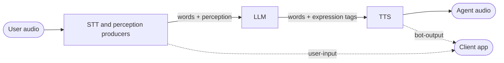

The Real-time Context Standard (RCS) defines how the models in a voice agent pass context to each other beyond plain text. A voice agent is a chain of models: speech-to-text transcribes the user, an LLM writes a reply, and text-to-speech speaks it. Between them they pass text, so what isn't words is lost along the way, such as how the user sounded, who said what, whether they meant to take a turn or were only saying "mm-hmm", and how the reply should be said. RCS carries that context in the same text stream, in formats any model in the chain can produce and read.

RCS Alpha carries how the user sounded and how the agent should speak. Who is speaking and when someone means to speak are on the [roadmap](#roadmap).

<Warning>
  This page documents RCS Alpha. Its formats, vocabularies and context types may
  change.
</Warning>

## Terms

- **Context model**: a model in a voice agent that produces or consumes context, such as a speech-to-text (STT) model, an LLM, a text-to-speech (TTS) model, or a classifier.
- **Context type**: a kind of context RCS carries. Each context type defines its direction, its format, its vocabulary, and how a model declares support for it.
- **Producer**: the model, or a processor beside it, that writes context of a type.
- **Consumer**: the model that reads it, or acts on it.
- **Capabilities**: what a producer reports or a consumer performs, declared before the conversation starts, so the models upstream only write what will be used.

## How Context Flows



A context type travels inline, with the words it describes. Context reaches client apps through the [RTVI standard](/api-reference/standards/rtvi-standard).

## Perception

How the user said what they said: their tone, how fast they spoke, and other signals read from the audio or the words.

- **Direction**: from an STT model, or a classifier model after it, to the LLM.
- **Producers**: any model that reads how a user turn was spoken.
- **Consumers**: the LLM, which reads it at the head of the user's message.

### Format

The reading comes first in the user's message, followed by a space and the words:

```text wrap
([tone frustrated=0.86, neutral=0.10],[speech_rate value=4.1]) Can you tell me where my order is?
```

- The reading is `(`, one or more signals separated by `,`, then `)`.
- A signal read as labels is `[name label=confidence, …]`: its likeliest labels, likeliest first, each with a confidence from 0 to 1 written to two decimals.
- A signal read as a value is `[name value=N]`, such as a rate or a level.
- Only a final reading of the turn is written. A turn with no reading has no prefix.

### Declaring Perception

A producer declares each signal it reports before the conversation starts, so the LLM can be told how to read them:

| Field         | Meaning                                                                 |
| ------------- | ----------------------------------------------------------------------- |
| `name`        | The signal's name, as written in a reading, such as `tone`              |
| `description` | A short line on how to read it, such as its unit or range, or empty     |
| `labels`      | The labels it can report, for a signal read as labels; empty for values |

RCS Alpha has no shared vocabulary of signals: a producer names its own.

## Expression

How the agent should say its reply: the delivery of its words, and the sounds and pauses between them.

- **Direction**: from the LLM, or a classifier model after it, to the TTS model.
- **Producers**: an LLM taught the tags, or a classifier model that adds tags to an LLM's plain reply.
- **Consumers**: the TTS model, and anything that follows the agent's delivery, such as a client application or a real-time avatar.

### Tags

| Tag                   | Example             | Description                                                                                                                                             |
| --------------------- | ------------------- | ------------------------------------------------------------------------------------------------------------------------------------------------------- |
| `<<delivery>>`        | `<<warm>>`          | Sets the delivery of the words after it, until the next delivery tag or the end of the response. A delivery can be several words, such as an accent     |
| `<<neutral>>`         | `<<neutral>>`       | Returns to the voice's baseline, until the next delivery tag or the end of the response                                                                 |
| `<<delivery: words>>` | `<<slow: 4 7 2 9>>` | A span: speaks just those words in that delivery, added to the delivery around them. `<<neutral: words>>` speaks them in the baseline. Spans don't nest |
| `^^words^^`           | `^^did^^ ship`      | Stresses the words                                                                                                                                      |
| `[[sound]]`           | `[[laugh]]`         | Makes a sound at that point                                                                                                                             |
| `[[pause N]]`         | `[[pause 600]]`     | Pauses for N milliseconds                                                                                                                               |

```text wrap
<<sympathetic>> I'm so sorry about the wait. <<warm>> Good news, though: it ^^did^^ ship yesterday. [[breath]] Your tracking number is <<slow: 4 7 2 9>>.
```

A consumer handles tags this way:

- **Tags are never spoken.** A consumer that can't perform a tag leaves it out of the speech.
- **Brackets decide the kind,** except that a universal name keeps its kind in the other brackets: `[[warm]]` still sets a delivery, and `<<laugh>>` is still a sound.
- **An unfinished tag** at the end of a response, or cut off by an interruption, is removed.
- **The reply keeps its tags as written** in the conversation's context.

### Universal Names

Deliveries and sounds are named by their universal names, the same whatever the TTS model. A consumer translates each into its own name for it, such as a TTS model that performs `warm` as `warmly`.

- **One spelling per word**: an adjective for a delivery, such as `nervous`, and a base word for a sound, such as `laugh`.
- **Different words stay distinct**, so `content` and `happy` are both names.
- **Only sounds a voice makes** have names. Sound effects, such as applause, have none.
- **Any other name** passes through as written, for a consumer that takes free text, such as an accent.

<AccordionGroup>
  <Accordion title="Deliveries (118)">
    `affectionate`, `agitated`, `alarmed`, `amazed`, `amused`, `angry`,
    `annoyed`, `anticipating`, `anxious`, `apologetic`, `appalled`, `ashamed`,
    `bored`, `calm`, `cautious`, `compassionate`, `confident`, `confused`,
    `contemplative`, `contemptuous`, `content`, `crying`, `curious`, `cute`,
    `deadpan`, `dejected`, `delighted`, `depressed`, `desperate`, `determined`,
    `disappointed`, `disdainful`, `disgusted`, `dismissive`, `distant`,
    `doubtful`, `dramatic`, `elated`, `embarrassed`, `empathetic`,
    `encouraging`, `enthusiastic`, `envious`, `euphoric`, `excited`, `fast`,
    `fearful`, `flirtatious`, `frustrated`, `grateful`, `guilty`, `happy`,
    `hesitant`, `hopeful`, `hurt`, `hysterical`, `impressed`, `indifferent`,
    `insecure`, `ironic`, `jealous`, `lonely`, `loud`, `mad`, `melancholic`,
    `mischievous`, `mocking`, `moved`, `muttering`, `mysterious`, `nervous`,
    `nostalgic`, `optimistic`, `outraged`, `panicked`, `peaceful`,
    `pessimistic`, `playful`, `professional`, `proud`, `questioning`,
    `reassuring`, `regretful`, `rejected`, `relaxed`, `relieved`, `resigned`,
    `sad`, `sarcastic`, `satisfied`, `scared`, `screaming`, `serene`, `serious`,
    `sheepish`, `shouting`, `sincere`, `singing`, `skeptical`, `slow`, `soft`,
    `somber`, `stern`, `surprised`, `sympathetic`, `thoughtful`, `threatened`,
    `tired`, `triumphant`, `trusting`, `uncertain`, `unhappy`, `upset`,
    `urgent`, `warm`, `whispering`, `wistful`, `worried`
  </Accordion>
  <Accordion title="Sounds (46)">
    `breath`, `burp`, `cackle`, `chuckle`, `clear throat`, `cough`, `cry`, `deep
    breath`, `exhale`, `gasp`, `giggle`, `groan`, `growl`, `grunt`, `gulp`,
    `hiccup`, `hiss`, `huff`, `hum`, `inhale`, `laugh`, `laugh harder`, `light
    breath`, `lip smack`, `moan`, `pant`, `scoff`, `sharp exhale`, `shriek`,
    `shush`, `sigh`, `sneeze`, `sniff`, `sniffle`, `snore`, `snort`, `sob`,
    `start laughing`, `swallow`, `tongue click`, `um`, `wheeze`, `whimper`,
    `whistle`, `woo`, `yawn`
  </Accordion>
</AccordionGroup>

### Declaring Expression

A TTS model declares what it performs before the conversation starts, so the producer is offered only those tags:

| Field                  | Meaning                                                                                                                                                 |
| ---------------------- | ------------------------------------------------------------------------------------------------------------------------------------------------------- |
| Deliveries             | The deliveries it performs, by its own names                                                                                                            |
| Sounds                 | The sounds it performs, by its own names                                                                                                                |
| Free text              | Whether it also takes deliveries, or sounds, described in a few words, declared for each kind on its own                                                |
| Universal names        | Its own name for each universal name, where they differ                                                                                                 |
| Pauses                 | The shortest and longest pause it makes, or none                                                                                                        |
| Emphasis               | Whether it stresses words                                                                                                                               |
| Where delivery changes | Anywhere in a response, or only between sentences. A model that changes it only between sentences speaks a span's whole sentence in the span's delivery |

## Reaching Clients

A client app sees context through [RTVI](/api-reference/standards/rtvi-standard) 2.3.0 and later:

- **`bot-output`** carries the delivery of the text just spoken, by its universal names, such as `["warm", "emphasis"]`, empty for the voice's baseline. Each sound and pause is a segment of its own, of type `expression_sound` or `expression_pause`.
- **`user-input`** carries a transcription's perception reading.

Transcripts and `bot-output` text never contain tags or readings.

## Implementations

### Pipecat

Pipecat 1.15.0 and later implement RCS Alpha with [expressive conversation](/pipecat/features/expressive-conversation), turned on with `PipelineParams(enable_expressive_conversation=True)`. See the [reference](/api-reference/server/expressive/overview) and the [examples](https://github.com/pipecat-ai/pipecat/tree/main/examples/expressive-conversation).

| Context type | Producers                                                                                  | Consumers                                                                                                                       |
| ------------ | ------------------------------------------------------------------------------------------ | ------------------------------------------------------------------------------------------------------------------------------- |
| Perception   | Pipecat Tone's reader (`PipecatToneReader`)                                                | Every LLM service                                                                                                               |
| Expression   | Every LLM service; Pipecat Tone's tagger (`PipecatToneTagger`) for an LLM that writes none | TTS: Azure, Cartesia, ElevenLabs, Fish Audio, Gemini, Inworld, MiniMax, Mistral and Soniox, on supported models. Avatars: Tavus |

By default, Pipecat offers the LLM its [core names](/api-reference/server/expressive/overview#core-names) that the TTS service performs.

## Roadmap

Context types under consideration for later versions:

- **Diarization**: who is speaking, for conversations with more than one person.
- **Intent**: when someone means to speak, and whether what they said needs a response.

## Contributing

RCS is an open standard, for any framework or model to produce and consume. To propose a change or a new context type, open an issue on [GitHub](https://github.com/pipecat-ai/pipecat/issues).
