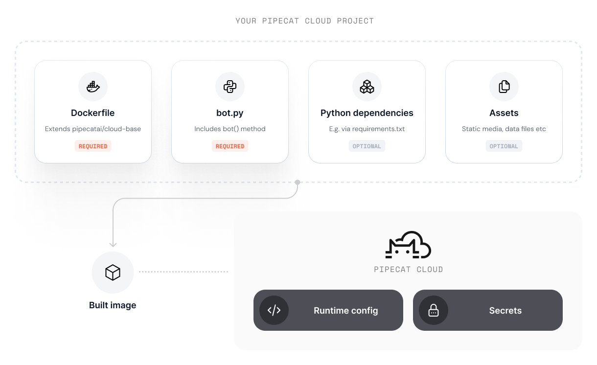

Pipecat Cloud agents are designed to be run from containerized images. This allows you to run the agent in a controlled environment, with all the dependencies and configurations needed.

Your project defines the environment that your agent will run using Docker and built using a Dockerfile in the root directory of the project.

For example, your Dockerfile might look like this:

<Tabs>
  <Tab title="Dockerfile using uv">
    ```dockerfile
    FROM dailyco/pipecat-base:latest-py3.14

    # Enable bytecode compilation
    ENV UV_COMPILE_BYTECODE=1

    # Copy from the cache instead of linking since it's a mounted volume
    ENV UV_LINK_MODE=copy

    # Uncomment this if you wish to print a summary of the features available in the base image.
    # ENV PCC_LOG_FEATURES_SUMMARY=true

    # Install the project's dependencies using the lockfile and settings
    RUN --mount=type=cache,target=/root/.cache/uv \
        --mount=type=bind,source=uv.lock,target=uv.lock \
        --mount=type=bind,source=pyproject.toml,target=pyproject.toml \
        uv sync --locked --no-install-project --no-dev

    # Copy the application code
    COPY ./bot.py bot.py
    ```

  </Tab>
  <Tab title="Dockerfile using pip">
    ```dockerfile
    FROM dailyco/pipecat-base:latest-py3.14

    COPY ./requirements.txt requirements.txt

    # Uncomment this if you wish to print a summary of the features available in the base image.
    # ENV PCC_LOG_FEATURES_SUMMARY=true

    RUN pip install --no-cache-dir --upgrade -r requirements.txt

    COPY ./bot.py bot.py
    ```

  </Tab>
</Tabs>

<Frame>
  
</Frame>

## Using an official base image

Pipecat Cloud provides a series of base images that we recommend for most use-cases. Base images provide:

- Simplified development and deployment
- Optimizations for performance and security

Using a base image reduces complexity in your project but requires you to adhere to a specific project structure.

- Your project must contain a `bot.py` file that defines the agent pipeline
- The `bot.py` must contain a `bot()` method that is the entry point for your agent pipeline
- The `bot()` method must be asynchronous, e.g. `async def bot():`
- Your image must install `pipecat-ai` 0.0.78 or newer

You do not need to specify a `CMD` as part of your Dockerfile - the base image is configured to run your `bot.py` module.

You can browse available base images in the [Pipecat Cloud Docker Hub <Icon icon="arrow-up-right-from-square" iconType="solid" />](https://hub.docker.com/u/dailyco).

### pipecat-ai version

The base image does not install `pipecat-ai`; your image does, at the version you choose. From base image 0.2.0, that version must be 0.0.78 or newer.

When the agent starts, the base image checks two things. Before it imports `bot.py`, it checks that `pipecat-ai` is installed. Right after, it checks that it can build the arguments it passes to `bot()`. If either check fails, the agent refuses to start and prints one line saying why, for example:

```
Refusing to start: pipecat-ai 0.0.76 is too old for this image, which needs pipecat-ai 0.0.78 or newer: upgrade pipecat-ai in the agent image and deploy again.
```

The new deployment never becomes ready. The line appears in the progress of `pipecat cloud deploy` and as the agent's health message. Agents already running from an earlier deployment keep serving. To fix it, raise `pipecat-ai` in your requirements and deploy again. If only SmallWebRTC's arguments fail to build, the agent starts anyway without SmallWebRTC, and logs why.

<Note>
  `pipecat-ai` older than 0.0.91 still works, but it is deprecated. The agent
  logs a warning at startup, and a future base image release will require 0.0.91
  or newer.
</Note>

### System packages

The base image installs only the system packages its own runtime needs, and keeps no apt package lists. To add a package, run `apt-get update` in the same `RUN` as the install:

```dockerfile
RUN apt-get update && \
    apt-get install -y --no-install-recommends libgl1 && \
    rm -rf /var/lib/apt/lists/*
```

Without `apt-get update`, the install fails with `E: Unable to locate package`. Install packages in your Dockerfile rather than in `pre-app.sh`, which runs each time a container starts.

A Python package that loads a system library the image doesn't have fails to import, with an `ImportError` that names the missing `.so` file. Install the Debian package that provides it. For example, `pipecat-ai` older than 1.6.0 imports OpenCV with `SmallWebRTCTransport`, which fails with `ImportError: libxcb.so.1: cannot open shared object file`: upgrade `pipecat-ai` to 1.6.0 or newer, or install `libgl1` as above.

### Reserved paths

The base image uses the `/app` directory for its internal operation. **Avoid copying files to `/app`** in your Dockerfile to prevent conflicts with system files.

<Warning>
  Writing to `/app` may overwrite critical system files and cause your
  deployment to fail. Your agent code should be placed in `bot.py` (required)
  and any additional modules, which the base image handles automatically.
</Warning>

### Reserved HTTP routes

The base image exposes the following HTTP routes for Pipecat Cloud platform integration:

| Route        | Method    | Description                                                                   |
| ------------ | --------- | ----------------------------------------------------------------------------- |
| `/bot`       | POST      | Main entry point called by Pipecat Cloud to start agent sessions              |
| `/ws`        | WebSocket | WebSocket endpoint for real-time communication (e.g., telephony integrations) |
| `/api/offer` | POST      | SmallWebRTC offer handling for peer-to-peer connections                       |
| `/api/offer` | PATCH     | SmallWebRTC ICE candidate handling                                            |
| `/whatsapp`  | POST      | WhatsApp Business webhook endpoint                                            |

<Note>
  These routes are automatically configured based on available features. For
  example, the `/whatsapp` route is only available when WhatsApp environment
  variables are configured.
</Note>

### Environment variables

The base image reads the following environment variables. Set them with `ENV` in your Dockerfile, or in a [secret set](/pipecat-cloud/fundamentals/secrets) attached to the deployment.

| Variable                     | Default                     | Description                                                                                                                                                                                                                                                                                                                                                             |
| ---------------------------- | --------------------------- | ----------------------------------------------------------------------------------------------------------------------------------------------------------------------------------------------------------------------------------------------------------------------------------------------------------------------------------------------------------------------- |
| `PIPECAT_LOG_LEVEL`          | `DEBUG`                     | Minimum [log level](/pipecat-cloud/fundamentals/logging#configuring-log-level) the agent writes.                                                                                                                                                                                                                                                                        |
| `PCC_LOG_FEATURES_SUMMARY`   | `false`                     | `true` logs which base image features are enabled when the agent starts. See [Logging available features](#logging-available-features).                                                                                                                                                                                                                                 |
| `PCC_RELEASE_SESSION_MEMORY` | `true`                      | After `bot()` returns, the image runs a garbage collection and returns freed memory to the OS, so the next session on the instance starts from a low baseline. `false` turns this off.                                                                                                                                                                                  |
| `PCC_EVAL_CONVERSATIONS`     | `false`                     | `true` publishes each session's whole conversation to Pipecat Cloud, tool call arguments included, when its pipeline finishes, so the call can be [judged](/api-reference/server/utilities/observers/eval-conversation-observer) after it ends. No effect when content is withheld, by Pipecat Cloud or by `PCC_WITHHOLD_CONTENT`. Requires `pipecat-ai` 1.13 or newer. |
| `PCC_WITHHOLD_CONTENT`       | unset                       | Keeps transcripts, error messages, and the `PCC_EVAL_CONVERSATIONS` conversation out of what the deployment publishes to Pipecat Cloud. Any value other than empty or `false` withholds. Can only make Pipecat Cloud's content setting stricter. Doesn't change the agent's logs.                                                                                       |
| `SHUTDOWN_TIMEOUT`           | `7200`                      | Seconds a stopping agent waits for running sessions to finish before it exits.                                                                                                                                                                                                                                                                                          |
| `ESP32_ENABLED`              | `false`                     | `true` makes SmallWebRTC answer offers in the form an ESP32 device accepts. Requires `ESP32_HOST`.                                                                                                                                                                                                                                                                      |
| `ESP32_HOST`                 | unset                       | IP address SmallWebRTC puts in its answer when `ESP32_ENABLED` is `true`.                                                                                                                                                                                                                                                                                               |
| `ICE_CONFIG_URL`             | Pipecat Cloud's ICE service | URL SmallWebRTC fetches ICE servers from for each offer. It must return `{"iceConfig": {"iceServers": [{"urls": ..., "username": ..., "credential": ...}]}}`. If the request fails, SmallWebRTC uses Google's public STUN server.                                                                                                                                       |

For example, to log at `INFO` and withhold conversation content:

```dockerfile
ENV PIPECAT_LOG_LEVEL=INFO
ENV PCC_WITHHOLD_CONTENT=true
```

Pipecat Cloud and the base image set `PORT`, `IMAGE_VERSION`, `PCC_TAG_DEPRECATION`, `PCC_EXCLUDE_CONTENT`, `PCC_LOG_DIR`, `PCC_SESSION_FILES_DIR`, `PCC_TERMINATION_LOG_PATH`, and `PIPECAT_EVENT_PUBLISHER_ENDPOINT`. Don't set these.

For WhatsApp integration, the following environment variables are required:

| Variable                   | Description                                  |
| -------------------------- | -------------------------------------------- |
| `WHATSAPP_TOKEN`           | WhatsApp API access token                    |
| `WHATSAPP_PHONE_NUMBER_ID` | WhatsApp Business phone number ID            |
| `WHATSAPP_APP_SECRET`      | WhatsApp app secret for webhook verification |

### Logging available features

To see which features are available in the base image at startup, set `PCC_LOG_FEATURES_SUMMARY=true`. This outputs a summary like:

```
2025-10-22 22:04:41.411 | INFO     | feature_manager:log_features_summary:287 - ============================================================
2025-10-22 22:04:41.411 | INFO     | feature_manager:log_features_summary:288 - Features available in this base image:
2025-10-22 22:04:41.412 | INFO     | feature_manager:log_features_summary:289 - ============================================================
2025-10-22 22:04:41.412 | INFO     | feature_manager:log_features_summary:299 - ✅ Daily Transport: ENABLED
2025-10-22 22:04:41.412 | INFO     | feature_manager:log_features_summary:299 - ✅ Websocket Transport: ENABLED
2025-10-22 22:04:41.412 | INFO     | feature_manager:log_features_summary:299 - ✅ SmallWebRTC Session Arguments: ENABLED
2025-10-22 22:04:41.412 | INFO     | feature_manager:log_features_summary:299 - ✅ SmallWebRTC Transport: ENABLED
2025-10-22 22:04:41.412 | INFO     | feature_manager:log_features_summary:299 - ✅ SmallWebRTC ICE Candidates: ENABLED
2025-10-22 22:04:41.412 | INFO     | feature_manager:log_features_summary:299 - ✅ WhatsApp Integration: ENABLED
2025-10-22 22:04:41.412 | INFO     | feature_manager:log_features_summary:314 - ============================================================
```

### Available base images

| Name                   | Description                                               |
| ---------------------- | --------------------------------------------------------- |
| `dailyco/pipecat-base` | Multi-modal Pipecat optimized, suitable for most use-case |

The base image supports Python 3.11, 3.12, 3.13, and 3.14. Each tag names its Python version with a `-py3.X` suffix.

<Note>
  Python 3.10 images were removed in base image 0.2.0.
  `dailyco/pipecat-base:0.1.32-py3.10` is the last one, and `latest-py3.10`
  stays on it. To take newer releases, move your image to Python 3.11 or later.
</Note>

**Latest tags:**

- `dailyco/pipecat-base:latest-py3.11` (Python 3.11)
- `dailyco/pipecat-base:latest-py3.12` (Python 3.12)
- `dailyco/pipecat-base:latest-py3.13` (Python 3.13)
- `dailyco/pipecat-base:latest-py3.14` (Python 3.14)

**Versioned tags:**

- `dailyco/pipecat-base:0.4.0-py3.11` (Python 3.11)
- `dailyco/pipecat-base:0.4.0-py3.12` (Python 3.12)
- `dailyco/pipecat-base:0.4.0-py3.13` (Python 3.13)
- `dailyco/pipecat-base:0.4.0-py3.14` (Python 3.14)

<Warning>
  `dailyco/pipecat-base:latest` and the version tags without `-py3.X`, such as
  `0.4.0`, are deprecated. They run Python 3.12. From 2027-04-05, `latest` gets
  no new releases, and new releases publish no tag without `-py3.X`. Tags
  already published stay available. An agent image built on `latest` or on a
  version tag without `-py3.X` from 0.4.0 on prints a deprecation warning in its
  build, and logs it at startup. `pipecat cloud deploy`, when it runs a cloud
  build, and `pipecat cloud docker build-push` also warn before building when a
  `FROM` line uses `dailyco/pipecat-base:latest` or `dailyco/pipecat-base` with
  no tag. To stay on Python 3.12, add `-py3.12` to the tag: `latest-py3.12`, or
  `0.4.0-py3.12` to pin a release.
</Warning>

<Tip>
  For production use, we recommend pinning to specific versions. A `:latest` tag
  can change without your project changing, so a deploy can leave your warm
  instances on the old image
  ([why](/pipecat-cloud/fundamentals/deploy#when-a-deploy-does-not-replace-running-agents)).
</Tip>

## Using a custom image

For more complex use-cases, you can use a custom image.

When doing so, we recommend following best practices to ensure your agent instance runs optimally on the platform.

Our [base image](https://github.com/daily-co/pipecat-cloud-images/tree/main/pipecat-base) is open source and serves as a useful blueprint for configuring your custom agent image.

### Agent image structure

<Warning>
Custom agent images are for advanced use cases. For most teams,
we recommend using our base images. If needed, consult the base
image code as a reference.

For unsupported use cases, contact us at help@daily.co or via
[Discord](https://discord.gg/dailyco).

</Warning>

Pipecat Cloud agent images must adhere to a specific structure to run on the platform. Our base images abstract away much of this complexity, but if you are building a custom image, you must ensure your agent adheres to the following:

- HTTP API that can handle requests from the platform to configure and run agent instances.
- The necessary system level dependencies (such as Python.)

In order to start an instance of your custom agent, you must expose a HTTP `POST /bot` route that will be called by the platform.

We recommend using FastAPI to create this route. Please refer to the base image code for an example of how to do this.

## Building the image

<Note>
  If you're using [cloud builds](/pipecat-cloud/guides/cloud-builds), you only
  need a Dockerfile in your project — the CLI builds and deploys your image
  automatically. The section below applies if you're building and pushing images
  to your own container registry.
</Note>

An agent image has to be built for the architecture its region runs. Daily-hosted regions run Linux on ARM, so build for `linux/arm64`:

```bash
docker build --platform linux/arm64 -t my-agent:latest .
```

Your agent image should include:

- All dependencies required for your agent to run.
- Assets (such as images or models) available in the container filesystem
- The entry point for your agent (usually a Python script)
- Additional system dependencies (if required)

### Best practices

- Keep your image as small as possible. Use multi-stage builds to reduce the size of the final image.
- Use a `.dockerignore` file to exclude unnecessary files from the image.
- Pipecat Cloud will automatically restart your agent if it crashes. Ensure your agent can handle this gracefully.
- Use [Secrets](./secrets) to securely store sensitive information in your agent image.
- To optimize for fast start-ups, avoid long running or blocking processes during initialization.
